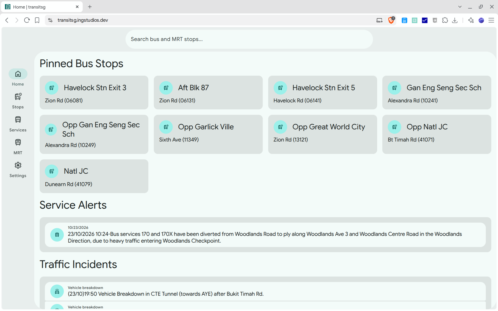
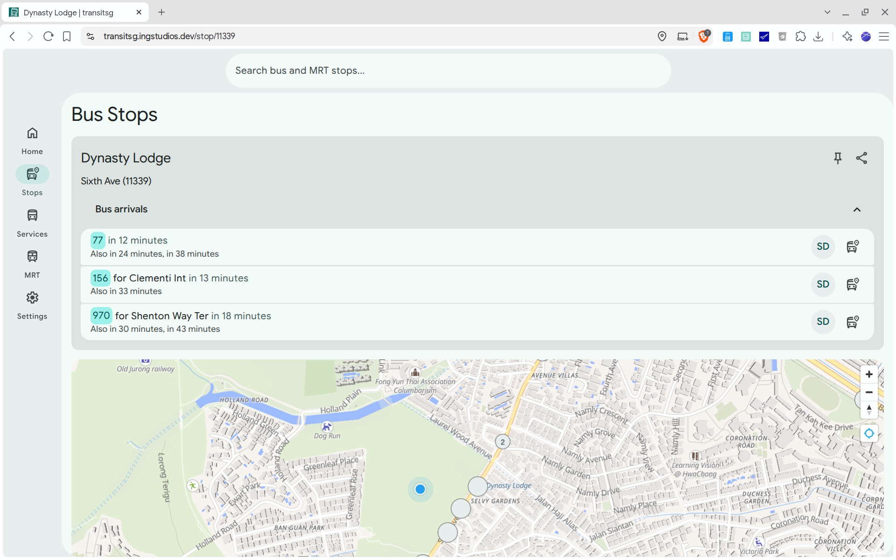
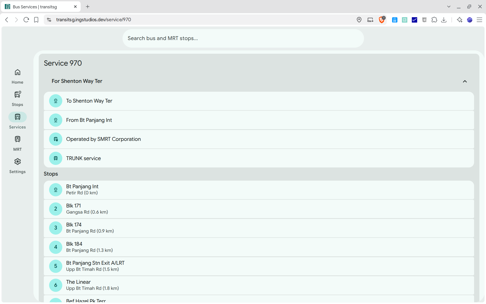
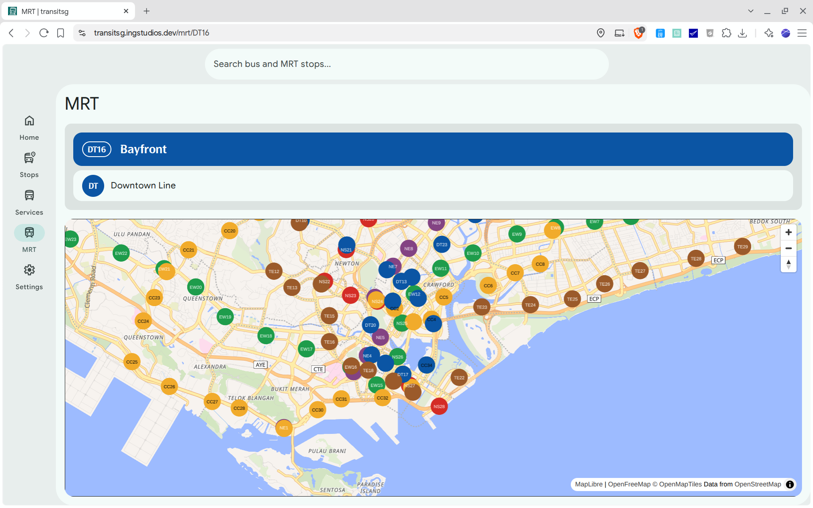

# transitsg

transitsg is a free and open-source web app for viewing Singapore bus arrivals, bus routes, bus stops, MRT stations and more.

Try it out [here](https://transitsg.ingstudios.dev)

## Gallery

## License

transitsg is licensed under the [Apache-2.0 License](./LICENSE).

© 2026 (ing) Studios and Ethan Lee Qi Yang
